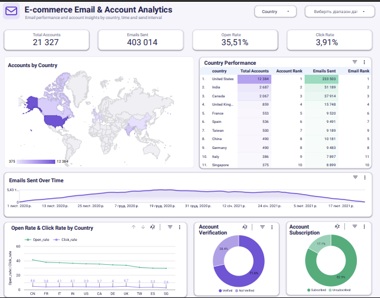

# E-commerce Email & Account Analytics

## Project Overview

This project analyzes user accounts and email activity for an e-commerce platform.

The goal is to understand account distribution, email engagement, and differences between countries.

The project uses **Google BigQuery** for SQL analysis and **Looker Studio** for data visualization.

## Tools Used

- Google BigQuery (SQL)
- Looker Studio
- GitHub

## Key Metrics

- Total Accounts
- Emails Sent
- Emails Opened
- Email Link Visits
- Open Rate and Click Rate
- Account Verification and Subscription Status

## SQL Analysis

The SQL query combines account, session, and email activity data.

It uses:

- Common Table Expressions (CTEs)
- JOIN operations
- UNION ALL
- Aggregation functions
- Window functions
- DENSE_RANK for country rankings

The final dataset includes countries ranked in the top 10 by total accounts or sent emails.

[View SQL Query](sql/account_email_analysis.sql)

## Dashboard

The interactive dashboard includes:

- Accounts by Country
- Country Performance
- Emails Sent Over Time
- Open Rate & Click Rate by Country
- Account Verification Status
- Account Subscription Status

## Key Insights

The United States has the highest number of accounts and sent emails among the analyzed countries.

The dashboard helps compare email activity, engagement, and account status across countries.

## Dashboard Link

https://datastudio.google.com/reporting/90362807-f536-4c10-87ac-f066a5c955bb 
